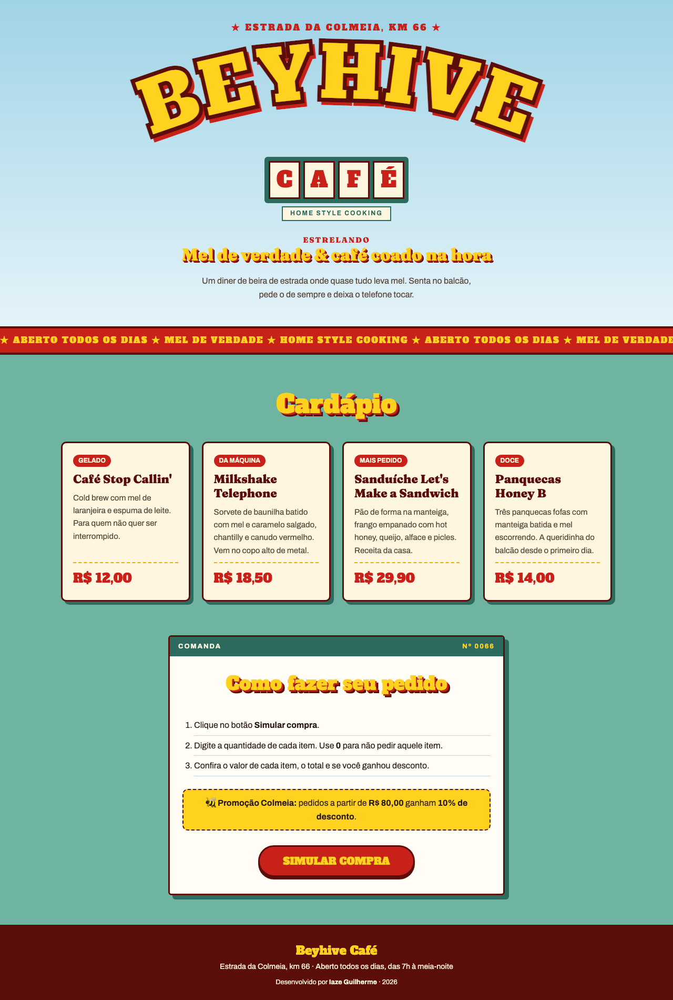

# 🐝 Beyhive Café: Simulador de Compras

**Aluno:** Iaze Guilherme
**Trilha:** Desenvolvimento Mobile
**Desafio:** Desafio 1, Minha Loja: Simulador de Compras

## Sobre a loja

O **Beyhive Café** é um diner de beira de estrada em que quase tudo leva mel. O nome vem de *Beyhive*, apelido dos fãs da Beyoncé, e a identidade visual é inspirada no clipe *Telephone* (Lady Gaga e Beyoncé): o título em letras amarelas com relevo vermelho imita o pôster do clipe, o letreiro com uma letra em cada placa lembra a fachada do diner ("HOME STYLE COOKING") e as cores seguem o céu azul, a parede verde-água e o vermelho da lanchonete. Os nomes dos produtos fazem referência ao clipe, como "Let's Make a Sandwich" e "Honey B", apelido da personagem da Beyoncé.

Fontes usadas (Google Fonts): **Alfa Slab One** nos títulos, **Fraunces** nos nomes dos produtos e **Archivo** no texto.

## Produtos e preços

| Produto | Categoria | Descrição | Preço |
|---|---|---|---|
| Café Stop Callin' | Gelado | Cold brew com mel de laranjeira e espuma de leite | R$ 12,00 |
| Milkshake Telephone | Da máquina | Baunilha batida com mel e caramelo salgado, chantilly | R$ 18,50 |
| Sanduíche Let's Make a Sandwich | Mais pedido | Pão na manteiga, frango empanado com hot honey, queijo, alface e picles | R$ 29,90 |
| Panquecas Honey B | Doce | Três panquecas com manteiga batida e mel | R$ 14,00 |

**Promoção Colmeia:** pedidos com subtotal a partir de **R$ 80,00** ganham **10% de desconto**.

## Captura de tela



## Tecnologias

- **HTML5**: estrutura da página (cabeçalho, cardápio, instruções e rodapé)
- **CSS3**: variáveis de cor, Grid para os cards, efeito hover, texto com relevo (`text-shadow`) e layout responsivo
- **SVG**: título em arco com `textPath`, como no pôster do clipe
- **JavaScript**: simulação da compra com `prompt()`, `Number()` e `alert()`

## Estrutura dos arquivos

```
beyhive-cafe/
├── index.html        # Página da loja
├── style.css         # Estilos
├── script.js         # Lógica da simulação
├── assets/
│   └── captura-tela.png
└── README.md
```

## Como executar

1. Clone o repositório:
   ```bash
   git clone <link-do-repositorio>
   ```
2. Abra o arquivo `index.html` no navegador (duplo clique já funciona, não precisa de servidor).
3. Clique em **Simular compra** e responda às perguntas com a quantidade de cada item.

## Como a simulação funciona

Ao clicar no botão, o atributo `onclick` chama a função `simularCompra()`, que:

1. Pergunta a quantidade de cada produto com `prompt()` e converte com `Number()` (dentro da função `perguntarQuantidade`).
2. Se todas as quantidades forem 0, mostra "Nenhum produto foi selecionado" e encerra.
3. Calcula o valor de cada produto: **preço × quantidade**, e soma o subtotal.
4. Verifica o desconto: se o subtotal for maior ou igual a R$ 80,00, aplica 10%. Se não for, informa quanto faltou.
5. Exibe com `alert()` a quantidade e o valor de cada produto, o subtotal, o desconto e o total.

Os preços em `script.js` são os mesmos exibidos na página.

## Testes realizados

| # | Entradas (Café, Milkshake, Sanduíche, Panquecas) | Resultado esperado | Resultado obtido |
|---|---|---|---|
| 1 | 1, 1, 1, 1 | Subtotal R$ 74,40, sem desconto, faltam R$ 5,60 | Correto |
| 2 | 2, 1, 2, 0 | Subtotal R$ 102,30, desconto R$ 10,23, total R$ 92,07 | Correto |
| 3 | 0, 0, 0, 0 | Mensagem "Nenhum produto foi selecionado" | Correto |
| 4 | `abc`, `-1`, `1.5`, depois 2, 0, 0, 0 | Três avisos de quantidade inválida, depois total R$ 24,00 | Correto |
| 5 | 2, 0, 0, 4 (exatamente R$ 80,00) | Desconto aplicado (regra usa `>=`): desconto R$ 8,00, total R$ 72,00 | Correto |
| 6 | 3, 0, 1, 1 (R$ 79,90, logo abaixo do limite) | Sem desconto, faltam R$ 0,10 | Correto |
| 7 | Cancelar em todas as perguntas | Mensagem "Nenhum produto foi selecionado" | Correto |

Também conferi manualmente que cada preço do `alert()` bate com o preço mostrado no card correspondente.

Observação: se o usuário clicar em **Cancelar** ou deixar o campo vazio, `Number()` converte para `0`, então o item é tratado como "não comprado".

## Dificuldade encontrada e aprendizado

A maior dificuldade foi lidar com o que o usuário digita no `prompt()`. Ele sempre retorna texto, e `Number("abc")` vira `NaN`, o que fazia o total aparecer como `NaN`. Resolvi criando a função `perguntarQuantidade`, que usa um `while` para repetir a pergunta enquanto a quantidade for inválida (texto, número negativo ou decimal).

Outro ponto foi a formatação de dinheiro: `toFixed(2)` mostra `74.40` com ponto. Criei a função `formatarReal` para trocar o ponto por vírgula e exibir no padrão brasileiro.

Aprendi a separar bem o projeto em HTML, CSS e JS, a converter e validar entradas e a organizar o código em funções pequenas com responsabilidades claras.

## Uso de IA

Usei o Claude (IA da Anthropic) como apoio para:

- Sugerir o tema do cardápio a partir da minha ideia de fazer algo sobre a Beyoncé e os álbuns.
- Gerar uma primeira versão do CSS.
- rodar os cenários de teste.
- Formular a identidade visual a partir da minha ideia de fazer algo inspirado no clipe *Telephone* e renomear os produtos para o tema, mantendo os mesmos preços.
